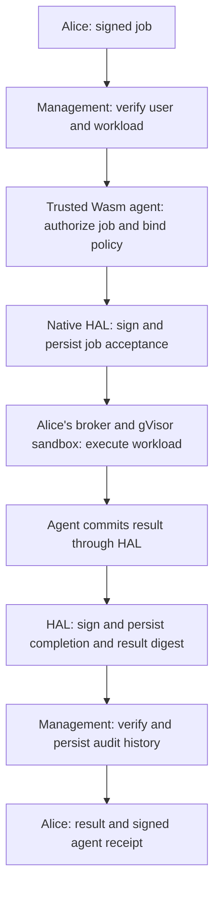

# Agent security audit trail

The shared agent architecture (`hal-managed-agent-v2`) now records signed security
events. Logging is mandatory in the native HAL launch and result-commit operations.
The agent decides whether a job may run; HAL makes those decisions durable. User
workloads receive neither an audit-writing interface nor the signing key.

This feature applies to the shared agent profile. It does not add an agent audit
trail to the legacy profile or the native benchmark baseline.

## What happens for a job



1. Management durably records its dispatch intent before sending the job.
2. The agent checks the request and selects the user and workload policy. HAL
   records `job_accepted` before dispatch to the user's broker.
3. On completion, the agent calls HAL's result-commit operation. HAL records
   `result_committed` before acknowledging the result.
4. Management verifies the signed result and collects the audit chain through
   that completion. It checks the record's user, job, artifact and result digest,
   then persists its acknowledgement before returning success.
5. The client validates the signed agent receipt and the normal workload output.

If storage fails before acceptance, that job is not dispatched. If execution may
already have happened but durable acknowledgement is unavailable, the response
remains **unknown**. The system does not automatically execute the job again.
A durable acceptance with no completion means an unresolved job, not proof of
failure or success.

## Records and verification

Agent events include activation, user enrollment, accepted jobs, committed
results and rejected control operations. Management separately signs platform
verification, activation, dispatch, acknowledgement and request-rejection events.

Job records identify the verified tenant and public key, job ID, artifact hash,
policy hash, enrollment revision and cache choice. Completion adds the outcome,
result digest and reported sandbox metadata. Rejections without an authenticated
user context are not attributed to a claimed user.

Audit records exclude private keys, bearer credentials, raw request bodies,
workload inputs, result contents and arbitrary exception text. Public-key
identifiers and digests are metadata, so access to the history is still restricted.

Every agent record contains a sequence number, previous-record hash, VM and
agent-instance identifiers, event time, and a management-signed agent identity
certificate. The native runtime signs each record with the agent identity key
generated inside the verified VM. That key is never sent into a workload sandbox.

Management verifies each certificate, signature and hash link, and stores the
verified chain and its last sequence/hash in its own persistent database. Export
responses also carry a fresh challenge and agent signature. Changing a record,
inserting a gap, or presenting a history behind management's saved checkpoint is
rejected. Old records remain verifiable after an agent restart because each keeps
its public certificate; certificate validity is checked at the record's event time.

The certificate is issued after the existing platform-verification flow. These
are **agent-signed records tied to that verified identity**, not a new hardware
attestation quote for every event or proof of continuous runtime integrity.
Event timestamps are the VM/service clock; sequence numbers establish log order.

The gateway also keeps bounded local operational records of rejections that
occur before the agent is reached. Those records are explicitly separate and
are not agent-signed or hardware-attested.

## User commands

Windows PowerShell, from the repository with `$HalPython` already configured:

```powershell
& $HalPython fleet.py audit --client state/alice.json
& $HalPython fleet.py audit --client state/alice.json --job-id "PASTE-THE-JOB-ID"
& $HalPython fleet.py audit --client state/alice.json --after 100 --limit 50
```

Linux/macOS:

```sh
.venv/bin/python fleet.py audit --client state/alice.json
.venv/bin/python fleet.py audit --client state/alice.json --job-id "PASTE-THE-JOB-ID"
.venv/bin/python fleet.py audit --client state/alice.json --after 100 --limit 50
```

Replace `100` with the previous response's `next_cursor`. The default page size
is 50, with a maximum of 100. An empty page means no further collected entries
matched the request. Audit retrieval reads management's retained history and does
not submit a workload or launch an agent. The API is `POST /v1/audit`, using a
signed request and a current identity document.

The response includes decoded event metadata and
`record_signatures_verified: true` after the client verifies the returned records.
Alice sees only records bound to both her tenant and her public key. A guessed
Bob job ID returns no Bob records. General platform and unauthenticated rejection
events are kept for the operator, not included in a user's view.

Management verifies the complete collected chain. A user's filtered view verifies
individual records; it is not a cryptographic proof that the subset is complete.
There is no Merkle inclusion/consistency API in this version.

For a job with an unknown outcome, retrieve its existing result and audit entries;
do not repeat `run` merely because acknowledgement failed. Collection can recover
on the next verified management session. Recovery does not silently change an
old unknown result into a completed result.

## Storage, recovery and rollout

On execution, the journal is `<state_dir>/audit/agent.jsonl`, outside the per-user
sandboxes and volatile agent credential directory. The directory is private, the
file is private, and only one runtime can hold its journal lock. Each append is
flushed to durable storage before proceeding. On management, verified history and
checkpoints live in `<state_dir>/state.sqlite3` with SQLite full synchronization.
The execution service's database holds its separate gateway operational records.

The execution `audit_max_bytes` setting defaults to 256 MiB (allowed: 1 MiB–4 GiB).
Management `audit_max_records` defaults to 200,000 (allowed: 1,000–5,000,000).
Admission leaves room for completion records. Limits stop new activity instead
of silently deleting old history. There is no automatic rotation, compaction or
remote archival service yet; monitor capacity and arrange protected backups
before extended operation. Back up SQLite consistently, including any live WAL,
using its backup mechanism or a clean service shutdown.

Restart verifies existing history. A partial write, invalid signature or broken
chain stops service/admission; the implementation does not discard the damaged
tail automatically. Preserve the files and investigate. Use a verified backup
for recovery, keeping management's saved checkpoints and the existing keys.
Deleting both the journal and its checkpoint would remove the rollback check.
Rollback of the entire management database is not detectable without an
independently retained checkpoint/backup.

Rebuild and deploy management and execution together using the existing
`deploy --portable-profile` workflow and existing keys/configuration. Management
requires the `hal-agent-audit-v1` runtime capability and rejects an older runtime
that cannot provide it. The existing WIT launch/commit signatures are unchanged;
their native implementation enforces the audit requirement. Existing pre-update
jobs do not acquire historical records retroactively.

This update adds signing, durable writes and collection work. Record the audit
profile when benchmarking; old measurements are not measurements of this profile.
`configuration.audit_log` and the session's `audit_log` identify the profile.
Local tests cover the implementation; actual TDX/SNP verification, gVisor behavior,
storage crash durability and performance still require target-VM validation.
