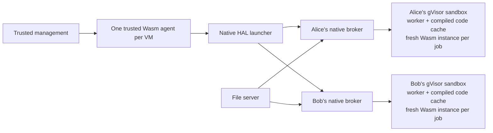

# One gVisor sandbox per user

Production Wasm workers now require **`gvisor-per-user-v1`**. Docker manages the
containers, but explicitly uses the `hal-gvisor` runtime instead of its default
runtime. The native baseline remains in process.



All of this execution machinery runs inside the enclosing TEE VM. The agent,
HAL launcher and brokers remain outside the workload sandboxes. Their trusted
code verifies jobs and supplies only authorized artifacts over private Unix
sockets. Agent identity keys and file-server credentials stay outside the workers.

Alice's functions share Alice's sandbox and its CPU, memory and process limits.
Bob gets a different sandbox. A fresh Wasm Store and the job's HAL access policy
are installed for every invocation, including cache hits. Compiled code is reused;
live workload instances are not. A compromise of Alice's native worker could
affect other workloads in Alice's sandbox. This design adds containment between
users; it does not add a separate native boundary between one user's functions.

## Install on an existing fleet

Use the existing deployment command from your provisioning computer, adding
`--install-dependencies` for the first gVisor installation. For the shared-agent
architecture, keep the existing portable profile:

```powershell
& $HalPython fleet.py deploy `
  --inventory state/fleet-inventory.json `
  --credentials state/fleet-tls `
  --ssh-key "$HOME/.ssh/id_ed25519" `
  --operator state/fleet-operator.json `
  --portable-profile state/portable-profile.json `
  --install-dependencies
```

The corresponding Mac/Linux command is:

```bash
.venv/bin/python fleet.py deploy \
  --inventory state/fleet-inventory.json \
  --credentials state/fleet-tls \
  --ssh-key "$HOME/.ssh/id_ed25519" \
  --operator state/fleet-operator.json \
  --portable-profile state/portable-profile.json \
  --install-dependencies
```

Use your actual existing profile path. An explicit legacy fleet deployment can
omit `--portable-profile`; its Wasm user containers also require gVisor after this
update. Ordinary users neither install nor select a runtime. Windows clients
need no Docker or gVisor installation, and their `onboard`, `run` and benchmark
commands remain the same.

Deployment stops this fleet's execution service, installs the official `runsc`
package when requested, registers the dedicated runtime, rebuilds the native
host and worker image, and runs signed-job sandbox acceptance tests **before
activating the execution API**. Other Docker runtime entries and the default
runtime are retained. Docker configuration is validated before replacement and
restored if reload/check fails; setup does not prune images or reset Docker data.
Existing registration keys, databases and ownership records are retained.

Installing/updating runtime software can change the approved VM software
configuration. Review it through your existing measured-boot and release process;
do not relax attestation policy to make an unexpected measurement pass. This
update does not create new approved hardware measurements automatically.

## Execution-VM checks

These commands run **on the Linux execution VM**, from its repository directory:

```bash
sudo .venv/bin/python -m hal_fleet.gvisor check
sudo .venv/bin/python -B tests/test_docker_workers.py --image hal-user-worker:local --signed-jobs
```

For an explicitly manual installation, stop the execution service, then run
`sudo .venv/bin/python -m hal_fleet.gvisor setup --install-dependencies` before the
normal build/image/test steps. Omit the installation flag when the official
package is already installed. A conflicting `hal-gvisor` entry is rejected for
operator review; it is not silently overwritten.

The profile in [src/gvisor-runtime.json](src/gvisor-runtime.json) is shared by the
installer, management checks and native launcher:

| Setting | Purpose |
|---|---|
| `--platform=systrap` | Works inside a VM without requiring nested KVM |
| `--network=none` | No general worker network access |
| `--host-uds=all` | Allows the two private broker/worker socket directions |
| `--directfs=false` | Filesystem access goes through the Gofer |
| `--file-access-mounts=shared` | Observe host-side IPC directory permission changes |
| `--allow-flag-override=false` | Refuse per-container annotation overrides |

Host socket support does **not** grant access to every host socket. Only the
user's configuration and private IPC directories are mounted; Docker/runsc
control sockets, other users' directories and TEE devices are not exposed. The
IPC directory becomes root-owned and non-writable before the first workload.
Read-only root, unprivileged UID, dropped capabilities, memory/CPU/PID limits,
private tmpfs and mandatory HAL permissions remain enabled.

The installer uses the [official signed package](https://gvisor.dev/docs/user_guide/install/),
which includes required runtime sidecars. The runtime choices follow gVisor's
[VM platform guidance](https://gvisor.dev/docs/architecture_guide/platforms/),
[filesystem controls](https://gvisor.dev/docs/user_guide/filesystem/) and
[host socket controls](https://gvisor.dev/docs/user_guide/observability/).

## Checks and result fields

Management requires the matching sandbox capability in the fresh
attestation-bound manifest before releasing agent credentials. Execution checks
the installed runtime configuration first. The native broker also checks Docker's
runtime registration and the actual container's launch configuration before
sending its first job. It checks the immutable image, user and broker ownership,
worker entrypoint, gVisor runtime, dropped capabilities, no-new-privileges,
private namespaces, disabled networking, CPU/memory/swap/PID limits and bounded
temporary storage. Only that user's configuration and IPC bind mounts are
accepted; added credential directories, runtime control sockets, other users'
directories and shared compiled-cache mounts are rejected. A failed check removes
the newly created container and leaves the user slot unavailable for investigation.
Missing/mismatched gVisor fails closed; there is no automatic fallback to runc.
The existing `per-user-container` ticket value is preserved for compatibility.

Successful production results identify `container.runtime = "hal-gvisor"`,
`container.sandbox_scope = "user"`, `container.sandbox_profile = "gvisor-per-user-v1"`
and `configuration.workload_sandbox`.

The result field `container.launch_configuration_checked` records this startup
check. It is not a claim of continuous worker integrity: the enclosing VM kernel,
Docker daemon and privileged launcher remain trusted, and operators must stop
the service before changing its sandbox configuration. No Docker inspection is
added to every warm invocation. Compiled caches remain in each user's worker;
management, file-server and agent identity credentials remain outside it. The
worker's freshly generated local token placeholders do not authorize it to any
external service.

The configuration check reports the runsc
version and executable digest. These are trusted software reports, not separate
hardware measurements of each Sentry, sidecar or container. A TDX quote alone
does not prove that a particular job used gVisor.

The real Linux tests exercise signed jobs, different users' private sandboxes,
same-user reuse across functions, cache hits/bypass, fresh Wasm instances,
restricted IPC/config mounts, host cgroup limits, and isolation when a worker dies.
Local Mac tests exercise the same native HAL and agent logic with explicit test
fixtures; they cannot validate Linux gVisor compatibility.

Benchmark again after deployment. Record sandbox startup separately from warm
jobs, and retain the runtime profile alongside the measurements. gVisor adds
runtime overhead; this change makes no performance-improvement claim.
