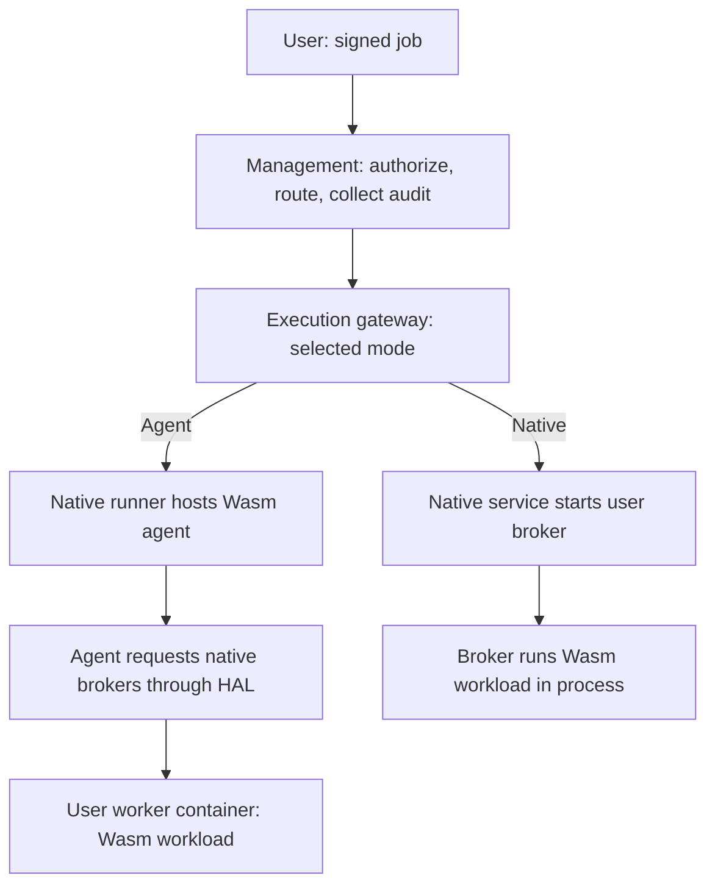

# Select native or agent mode from management

Prepare the agent and audited native profiles using [FLEET.md](FLEET.md)
and [NATIVE_AUDIT_BENCHMARKS.md](NATIVE_AUDIT_BENCHMARKS.md) before configuring a selector.

Management keeps the same HTTPS address. After one-time setup, the operator can
select either implementation from the management VM. Users keep the same user
identity and workload catalog; they use the client profile for the selected mode.
The native and agent services retain separate databases, keys, logs and results.

```sh
# On the management VM, as the management service user
.venv/bin/python fleet.py mode-status --config state/modes/management.json
.venv/bin/python fleet.py mode-select --config state/modes/management.json --mode native
.venv/bin/python fleet.py mode-select --config state/modes/management.json --mode agent
```

These are explicit operator commands, not flags that users can attach to jobs.
They require the existing agent management owner's private key, which stays on
management. Mode selection uses signed, replay-checked HTTPS requests. The separate
native management audit key is not allowed to change the VM's mode.

## How management behaves

| Responsibility | Agent mode | Native mode |
|---|---|---|
| Activation | Existing deployment routine obtains fresh VM evidence, verifies the configured policy, then deploys the Wasm agent and provisions credentials | Activates the native service profile and verifies its signed audit identity/chain; no Wasm agent deployment |
| Job admission | Checks the user's grant, workload and replay state | Checks the user's grant, workload and replay state |
| Routing | Sends the job through the existing execution gateway and authenticated agent channel | Sends an authenticated request to the native execution gateway |
| Starting brokers | The Wasm agent requests native broker creation through the extended HAL | The native execution service starts the user's broker directly |
| Running workloads | Fresh workload instance in the user's worker container | Fresh Wasm workload instance inside the user's native broker |
| Code reuse | Existing agent `bypass` and `reuse` policies | Only `bypass`; native reuse is rejected |
| Completion | Verifies and persists the collected signed audit record before acknowledging success | Verifies and persists the collected signed native audit record before acknowledging success |
| Attestation claim | Existing session and deployment verification | `false`; an audit certificate is not a hardware attestation |



The selector is Python service control around the existing implementations.
It does not move brokers into Wasm or change the agent's WIT interface, native
runner, attestation verifier, orchestration code or broker/container lifecycle.
Installing the base HAL remains separate from deploying the agent. There is still
one deployed orchestration agent per execution VM in agent mode.

## What a switch does

1. Management refuses a switch while a benchmark lease is active. Finish the
   experiment, or release an interrupted experiment after its outstanding jobs drain.
2. It durably closes job/session admission and waits for existing HTTP work and
   management acknowledgements to finish. The optional `--drain-seconds` is 0–60
   seconds for a drain wait, not a deadline for the entire switch.
3. Leaving agent mode uses the existing drain, final-audit-collection and retirement
   protocol. The agent runner and its brokers/workers must be confirmed stopped.
   The VM's ownership record is retained.
4. Leaving native mode closes admission on execution too. Each broker must have
   zero active requests; its operator statistics are checked. It receives SIGTERM
   and must exit with code zero. The selector never force-kills a broker to finish
   a switch. Execution signs a final drain checkpoint; management collects it.
5. The execution service closes the old profile and opens the destination profile.
   Management does the same. Existing logs, audit history and result files remain
   in their original profile directories.
6. Entering agent mode calls the existing deployment routine, including fresh
   attestation verification. Entering native mode collects and verifies the native
   startup audit. Only then does management reopen admission.

A failed switch stays pending and blocks jobs. `mode-status` shows both services'
phases and the operation ID. Resolve the reported problem and rerun **the same
target mode**; the durable operation ID is reused. There is no automatic fallback,
automatic job retry or deletion of old state. A lost acknowledgement cannot create
a second switch operation. Selecting the already-ready mode is a no-op.

`activation_attestation_verified` records whether that activation went through
the agent verification path. It is not a continuously fresh attestation result;
the existing attested session checks remain authoritative. `/health` is service
liveness; use `mode-status` and its `phase: ready` for mode readiness.

## One-time installation

This version selects modes for **one shared execution VM**. Configure matching
agent and native profiles on both VMs. Existing standalone multi-VM agent routing
is unchanged; it is not enabled by this selector.

First follow [NATIVE_AUDIT_BENCHMARKS.md](NATIVE_AUDIT_BENCHMARKS.md) to create the
separate audited-native keys, certificate and profiles and to authorize its key on
Files. Keep the existing working agent profile and attestation policy. Both
profiles must use the same HTTPS endpoints, trust, listener and TLS files.

Create selectors without editing either underlying profile:

```sh
# Management VM: state/fleet.json is the existing managed-agent profile
.venv/bin/python fleet.py configure-modes \
  --agent-config state/fleet.json --native-config state/native/management.json \
  --output state/modes/management.json

# Execution VM: use the mode_control_public_key printed above (public only)
sudo .venv/bin/python fleet.py configure-modes \
  --agent-config state/fleet.json --native-config state/native/execution.json \
  --control-public-key AGENT_MANAGEMENT_PUBLIC_KEY_HEX \
  --output state/modes/execution.json
```

Private files on execution belong to root; private files on management belong to
its service user. Configuration records hashes of both profiles. Changing a
profile after setup is rejected; review build/configuration changes during a
maintenance window and create a new selector configuration, preserving history.

Before replacing the original services, finish benchmarks and retire a currently
deployed agent with the original management command:

```sh
.venv/bin/python fleet.py agent-undeploy --config state/fleet.json \
  --execution-url https://EXECUTION_VM --drain-seconds 60
```

Require the `undeployed` receipt before stopping that service. This retirement
command is unnecessary for a base where no agent was ever deployed. If starting
from a native-only service, drain its requests before stopping it. Do not force
service shutdown to get past incomplete cleanup.

Stop/disable the old management and execution units on their respective VMs.
Install the selector using the existing unit names so routine restarts use it:

```sh
# Execution VM
sudo .venv/bin/python fleet.py unit --config state/modes/execution.json > /tmp/hal-fleet-execution.service
sudo install -m 0644 /tmp/hal-fleet-execution.service /etc/systemd/system/hal-fleet-execution.service
sudo systemctl daemon-reload
sudo systemctl enable --now hal-fleet-execution.service

# Management VM: generate as the service user so the unit keeps its identity
.venv/bin/python fleet.py unit --config state/modes/management.json > /tmp/hal-fleet-management.service
sudo install -m 0644 /tmp/hal-fleet-management.service /etc/systemd/system/hal-fleet-management.service
sudo systemctl daemon-reload
sudo systemctl enable --now hal-fleet-management.service
```

Do not also start `hal-native-*` or a second standalone agent service. A VM-wide
execution lock and per-profile state locks reject overlapping managed services.
The initial selector state is `inactive`. Run `mode-select` on management to
activate the desired profile. Later switches require neither SSH into execution
nor systemd restarts. No setup command above runs an experiment.

## Benchmark and recovery rules

Use the matching `alice-agent-audited.json` or `alice-native-audited.json` client
profile from the benchmark guide. A client pinned to agent execution refuses a
native session. Reopen the session after each switch; old epochs/channels are not
reused. Audit/result APIs show the active profile's history; inactive history
remains on disk and is available when that profile is selected again.

Every successful selection has a new generation ID, except an already-selected
no-op. Benchmarks pin it alongside the workload hashes, execution identity, build,
management process and runtime settings. A changed generation invalidates the
experiment. Finish one experiment, switch, then start a **new** experiment/output
directory. Startup and switching time remain outside measured batches. Agent
reuse batches still have their explicit warm-up phase.

These are operational safeguards against accidental mixing. They do not make CPU
limits, isolation, attestation costs or background machine load identical. The
VM-wide lock also cannot constrain an administrator starting unmanaged processes.

Offline mode-control tests are in `tests/test_mode_selection.py`. They exercise
signatures, separate audit databases, drain failures, benchmark races and durable
recovery. They use fixtures for TEE evidence and processes. Validate real
agent→native→agent transitions, final audit collection and process/container exit
on the execution VM before using the selector for published benchmark results.
