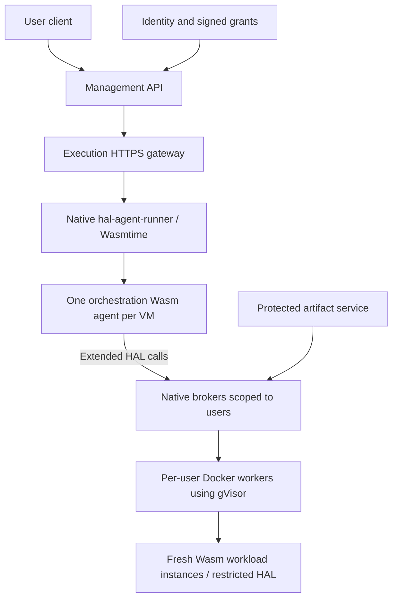

# HAL on demand

A Wasm agent that manages authorized workload execution through an extended HAL
(Hardware Abstraction Layer). The repository includes the native Rust host,
the Wasm agents, four Python API services, isolation and audit enforcement,
and an audited native baseline for benchmarks.

The current managed architecture deploys **one orchestration agent per execution
VM**. The agent requests native broker creation through WIT-defined host calls.
The native host enforces the authorized user, workload, policy and execution
target. A cache hit reuses prepared code; every job still needs authorization and
runs in a fresh workload instance.



Management verifies the configured attestation policy before provisioning an
agent and its scoped credentials. The native runner, brokers, operating system
and sandbox remain part of the trusted implementation. Attestation is not a proof
of arbitrary workload correctness or continuous runtime integrity.

## What is included

- Management-owned agent deployment, authorization, lifecycle and audit protocols.
- Native HAL implementations and WIT interfaces for orchestration and jobs.
- Per-user workers, private code caches, gVisor configuration and workload access profiles.
- An audited native mode that runs Wasm workloads directly in native brokers,
  with cache reuse disabled and without worker containers.
- Individual administration commands in `fleet.py`, source/build tools, tests and
  a benchmark matrix that preserves failures and records execution profiles.

This source distribution contains no cloud fleet provisioner, all-in-one
setup/benchmark wrapper, deployment-specific recovery script, saved credentials,
VM state, historical benchmark results or presentation files. Infrastructure and
approved attestation baselines are supplied by the operator. The optional
`fleet.py deploy` command installs the four services on an existing inventory;
it does not create cloud VMs or approve their measurements.

## Build locally

Use Python 3.9 or newer and Rust **1.98.1**, with the `wasm32-wasip2` target.
The compiler is pinned because newer Rust WASI imports may be incompatible with
Wasmtime 25.0.3. `build.py --install-target` installs the pinned toolchain/target
through an existing Rustup installation when needed.

```sh
python3 -m venv .venv

.venv/bin/python -m pip install -r requirements-signing.txt

.venv/bin/python build.py --install-target

.venv/bin/python benchmarks/build.py --install-target
```

The first build produces `dist/hal-on-demand`, `dist/hal-agent-runner`,
`dist/agent.wasm`, `dist/orchestration-agent.wasm` and a build manifest. The second
build produces 15 computational workload components and their publication
manifest in `benchmarks/artifacts/`. Generated output is ignored by Git.

`dist/orchestration-agent.wasm` is the VM-level agent used by the current
managed profile. `dist/agent.wasm` belongs to the broker job interface and the
earlier local test path. They implement different WIT worlds and are not
interchangeable.

Use `--offline` only after the required Rust dependencies are available locally.
Build the native executables for the execution machine's CPU and OS; a Mac host
binary cannot be installed as a Linux execution binary.

## Test

After both builds:

```sh
.venv/bin/python -B tests/run_architecture_checks.py

.venv/bin/python -B tests/run_trustee_checks.py
```

These local checks use temporary state. Integration tests need loopback sockets
and run real Wasm/native code, but use explicit fixtures for hardware evidence.
They do not attest the development computer. See [TESTING.md](TESTING.md) for
the separate Linux Docker/gVisor and TEE acceptance checks.

## Use and understand the system

Start with [FLEET.md](FLEET.md). Service installation and agent
activation are separate operations; creating a client profile does not switch
the running services.

| Topic | Guide |
|---|---|
| Service roles and individual deployment commands | [FLEET.md](FLEET.md) |
| Shared agent, WIT/HAL boundaries, attestation and lifecycle | [PORTABLE_AGENT.md](PORTABLE_AGENT.md) |
| Trustee configuration and policy verification | [TRUSTEE.md](TRUSTEE.md) |
| gVisor worker restrictions | [GVISOR.md](GVISOR.md) |
| Individual workload permissions | [WORKLOAD_ACCESS.md](WORKLOAD_ACCESS.md) |
| Audit records and persistence | [AUDIT.md](AUDIT.md) |
| Audited native baseline | [NATIVE_AUDIT_BENCHMARKS.md](NATIVE_AUDIT_BENCHMARKS.md) |
| Optional mode selector | [MODE_SELECTION.md](MODE_SELECTION.md) |
| Workloads, benchmark commands and timing definitions | [benchmarks/README.md](benchmarks/README.md) |
| API and Windows client | [FLEET_API.md](FLEET_API.md), [WINDOWS.md](WINDOWS.md) |

## Source layout

| Path | Purpose |
|---|---|
| `orchestrator/`, `wit-orchestration/` | VM orchestration agent and its host interface |
| `guest/`, `wit/` | Broker job agent and job/service interface |
| `src/` | Native runner, brokers, workload execution, authorization, caches and workers |
| `hal_fleet/`, `fleet.py` | Identity, files, management and execution API services and CLI |
| `vendor/` | Vendored HAL/runtime and access-profile implementation, with provenance |
| `containers/` | Worker image definition; build instructions are in [GVISOR.md](GVISOR.md) |
| `benchmarks/` | 15 computation workloads, independent reference checks and benchmark tools |
| `tests/` | Unit/integration checks and the five original Wasm test fixtures |
| `examples/` | Placeholder inventory, workload specification and policy templates |
| `tools/trustee-snp-codec/` | Management-side SNP report format adapter |
| `server/` and root configuration tools | Earlier local HTTP path retained for compatibility tests |

`state/`, `dist/`, `target/`, `validation/` and `results/` are created locally as
needed. They are not source inputs and must not be committed. Private state files
must retain their service account ownership and mode `0600` on POSIX systems.

