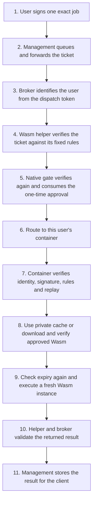

# The helper's rules and signed job approvals

For an existing signed deployment, use the [saved deployment workflow](#saved-deployment-workflow) below. It replaces timestamped policy variables and repeated long launch commands. The earlier sections still explain initial provisioning and the security checks.

The helper now checks a permission slip signed by the user. Management can carry the slip, but it cannot change who the job belongs to, change the Wasm file, or make a new slip for another user. The helper follows rules installed by the execution operator. A job cannot replace those rules.

The container checks the same slip again. If management sends Alice's approved job through Bob's execution account, or a dispatcher sends it to Bob's container, it is rejected. Both users may be allowed the same Wasm file; that does not make their signatures interchangeable.

This protection is enabled by `--job-authorization PATH` on the execution host. Keep `--user-containers` for the separate operating-system boundary. Without `--job-authorization`, the earlier token-and-allowlist mode remains available for baseline comparisons and **does not require user signatures**. Check `configuration.signed_jobs_required: true` before using this as the signed-job design.

## Who holds what

| Component | What it receives | What it may do |
|---|---|---|
| User's client | That user's private signing key, approved workload metadata and API token | Sign the exact jobs that user chooses to submit |
| Management | API/dispatch tokens and signed tickets | Queue and forward jobs; cannot create new valid user signatures |
| Wasm helper | Public verification key and immutable rules for its user/workload | Verify the signature and all job restrictions before requesting any execution capability |
| Native broker | Operator-owned public policy, credentials and container configuration | Check authorization again, reject replay, and route to the authenticated user's worker |
| User's container worker | Only its own user's public policy and fixed identity | Verify the ticket again before using its private cache or executing |
| File server | Compiled Wasm files | Serve bytes; it has no signing keys and chooses no execution permissions |

The private key stays on a separate user/client machine. Running the signer on the same management VM is acceptable for a local wiring test, but then a management-VM administrator can obtain that key. Such a test does not establish protection from a compromised management VM.

The operator remains trusted to approve users' public keys and workload permissions. Management cannot update that policy through an API. A changed policy requires operator action and a host restart.

## What each approval contains

A ticket binds the user, deployment audience, current host session, job ID, random nonce, operation, filename, SHA-256, exact file size, cache choice, workload-policy digest, isolation mode, issue time and expiry. The operation is currently `run()` with **no input argument**. A ticket cannot grant a shell command, another HAL interface, a different container image, or a new download URL.

The workload-policy digest covers HAL permissions, memory/fuel/time/output limits, expected result, cache lifetime and worker recycling. The helper receives its context once when it is initialized and refuses replacement. The native gate also verifies signatures; replacing the helper with one that skips checks is not a permission grant. The trusted agent digest still pins the approved Wasm component.

Tickets use Ed25519. The signature covers a fixed protocol prefix and the original UTF-8 payload bytes. Typed claim parsing rejects unknown or duplicate fields. This is a small application-specific envelope, not a general JWT implementation. Verification uses [`ed25519-dalek` strict verification](https://docs.rs/ed25519-dalek/2.2.0/ed25519_dalek/struct.VerifyingKey.html#method.verify_strict); the Python client uses the [cryptography Ed25519 implementation](https://cryptography.io/en/latest/hazmat/primitives/asymmetric/ed25519/).



## Replay, expiration and failures

- Each execution host creates a fresh random **epoch** when it starts. A ticket is valid only for that epoch and its configured audience. Old tickets cannot be reused after a restart, even though the old in-memory replay history is gone.
- The broker consumes each user's job ID and nonce atomically across helper instances. A container has its own independent replay check. Two concurrent copies cannot produce two accepted executions on that host.
- Consumed IDs are never evicted during an epoch, even after expiry. That avoids making them usable again after a clock adjustment. The limit is 100,000 accepted approvals per user per epoch; at the limit admission fails closed. Restart to create a new epoch, then use new client tickets. This first design does not provide an unbounded durable authorization history.
- Default ticket lifetime is 120 seconds; the operator can select 1–300 seconds. Issue time may be at most five seconds ahead of the verifier's clock. Keep client and execution-VM clocks synchronized. A ticket that expires while queued or compiling is rejected before execution starts. Expiry does not undo a job already running; fuel and execution timeout bound that job.
- Once an approval has been consumed, an execution failure does not make it reusable. Look up its status. Do not automatically create a second approval for a job whose outcome is uncertain.
- Job ID deduplication at management still works for an identical stored request. Reissuing a signature under the same ID changes the request and conflicts; use `jobs.py status JOB_ID` to retrieve the original result.

## Setup: build the matching host, helper and worker image

On the **execution VM**, use the updated full source folder:

```bash
cd ~/hal-agent-complete/hal-on-demand
python3 build.py --install-target

sudo /usr/bin/docker --host unix:///var/run/docker.sock build \
  -f containers/Dockerfile -t hal-user-worker:local .
```

Adjust the folder path to your checkout. Build as your normal user. The agent WIT interface is now `elastic:job-agent@0.4.0`; an older host, helper or worker image will not implement these checks. Follow [the container guide](containers/README.md) to generate and review an agent policy that pins the new `dist/agent.wasm` digest. Keep any custom restrictions from your prior policy.

## Setup: provision the user keys away from management

On the **trusted provisioning/client machine**, install the optional signing dependency in a virtual environment:

```bash
python3 -m venv .venv-signing
.venv-signing/bin/python -m pip install -r requirements-signing.txt
```

Place copies of the reviewed execution tenant policy, reviewed new agent policy and matching workload catalog in `reviewed/` under these names. These copies contain permissions and token **filenames**, not token contents. They must match the execution VM's approved files. Do not obtain an unreviewed signing catalog from management at job-submission time.

```text
reviewed/execution-policy.json
reviewed/agent-policy.json
reviewed/workloads.json
```

Generate new keys and public approval rules:

```bash
.venv-signing/bin/python configure_authorization.py \
  --tenant-policy reviewed/execution-policy.json \
  --agent-policy reviewed/agent-policy.json \
  --catalog reviewed/workloads.json \
  --audience intel-worker-1 \
  --isolation per-user-container \
  --ttl-seconds 120 \
  --output-dir state/job-approvals-01
```

Choose a unique audience name for this execution deployment. The generator refuses to overwrite an existing output directory. It creates:

| Generated file | Destination |
|---|---|
| `execution-public/job-authorization.json` | Execution VM only, alongside its operator-owned policies |
| `clients-private/alice.json` | Alice's client machine only |
| `clients-private/bob.json`, if Bob is configured | Bob's client machine only |

Alice and Bob are example user identities, not additional management servers. The generator makes one signing key per user already listed in your tenant policy. Do **not** copy the whole generated directory to every VM. Keep client files owned by their user with mode `600`. Management, workers and the file server need no private keys. The generator is an initial provisioning tool, not an automatic key-rotation service.

Copy **only** the public execution file to, for example:

```text
~/hal-agent-complete/hal-on-demand/state/tenant-config/job-authorization.json
```

If an existing public policy is already deployed, review the replacement as a key/policy change. Revocation or changed permissions require a restart and updated client configuration; old tickets become invalid because the epoch changes.

## Setup: start execution and management

On the **execution VM**, add this argument to the container launch command from the [container guide](containers/README.md):

```bash
--job-authorization "$PWD/state/tenant-config/job-authorization.json"
```

The command must still contain `--mode wasm`, `--user-containers`, `--tenant-policy`, `--agent-policy` and the correct file-server URL. The public authorization file pins the exact workload rules; startup rejects inconsistent policies instead of silently accepting weaker settings.

On the **management VM**, use the updated `server/management.py`. Keep its existing endpoint, tenant policy, catalog and tokens; add:

```bash
--require-signed-jobs
```

This management flag gives an early error for missing tickets. The execution host's `--job-authorization` is the security requirement: even a dispatcher that removes its own check still cannot run an unsigned job on that host. Management does not need `cryptography` installed.

The file server requires no changes. Your existing Nginx configuration and files are compatible.

## Obtain the current public epoch

On the **execution VM**, query its operator endpoint:

```bash
HAL_OPERATOR_TOKEN=$(cat "$PWD/state/tenant-config/operator.token")
curl --fail --silent --show-error --noproxy '*' \
  --connect-timeout 3 --max-time 10 \
  -H "Authorization: Bearer $HAL_OPERATOR_TOKEN" \
  http://127.0.0.1:9100/v1/stats \
  | python3 -c 'import json,sys; print(json.load(sys.stdin)["job_authorization"]["epoch"])'
unset HAL_OPERATOR_TOKEN
```

The printed 64-character epoch is public. Give it to the signing client; do not give the client the operator token. The startup JSON also reports this epoch. A wrong or stale epoch causes rejection, not permission to use another deployment.

## Submit and benchmark from the user's client

On the **client machine**, set the management URL, the public epoch just obtained, and the path to that user's management API token. Use your real management DNS/IP and port. The example token path below is a client-side copy of Alice's API token, not the execution token.

```bash
HAL_MANAGEMENT_URL='http://YOUR_MANAGEMENT_VM:9000'
HAL_AUTH_EPOCH='PASTE_THE_64_CHARACTER_EPOCH_HERE'
HAL_CLIENT_TOKEN="$PWD/state/alice-api.token"

.venv-signing/bin/python jobs.py \
  --url "$HAL_MANAGEMENT_URL" \
  --token-file "$HAL_CLIENT_TOKEN" \
  --signing-config "$PWD/state/job-approvals-01/clients-private/alice.json" \
  --authorization-epoch "$HAL_AUTH_EPOCH" \
  submit --case platform --cache bypass --wait
```

A successful container result includes `job_authorization.verified`, `helper_checked`, `broker_checked` and `worker_checked`, all `true`; `configuration.signed_jobs_required` is also `true`. `attestation_verified` remains `false`.

For a 1,000-job test, use the same client arguments and replace the last line with:

```bash
bench --jobs 1000 --concurrency 4 --cache bypass \
  --expect-mode wasm --expect-isolation per-user-container \
  --expect-compile-opt-level speed \
  --output "results/signed-container-bypass-q4-$(date -u +%Y%m%dT%H%M%SZ)"
```

Repeat with concurrency 1 and 2, and with `--cache reuse`. For a warm-cache measurement, first submit five jobs with reuse and check that all five cases ran, then confirm the measured run reports hits. Do not call a container's first startup a warm execution. Ticket signing occurs when each request is submitted, so a whole 1,000-job test need not finish within one ticket's lifetime.

Client signing and all execution-side checks are included in end-to-end batch timing. The benchmark records the public signing context in `config.json` and checks reported authorization before counting a job as completed. It never records the private key. These checks add work; there is no promised percentage speedup. Compare matched security/configuration profiles and retain the old unsigned results as a separate baseline.

## Validation and limits

Run software tests after building both artifacts:

```bash
python3 -B tests/validate_agent.py \
  --signing-python "$PWD/.venv-signing/bin/python" \
  --output "validation/signed-jobs-$(date -u +%Y%m%dT%H%M%SZ)"
```

On Linux, also test the actual Docker handoff with the matching image. This command needs the signing dependency **only for generating temporary test keys**, not for the production worker:

```bash
sudo "$PWD/.venv-signing/bin/python" -B tests/test_docker_workers.py \
  --image hal-user-worker:local --signed-jobs
```

Signed tickets authorize execution. They do not encrypt the HTTP connection, sign the returned result, perform remote attestation, or prevent management from dropping/delaying jobs. For the current benchmark, keep the existing network restriction; use authenticated encrypted transport before carrying sensitive production data. Hardware-protected result evidence is a separate unimplemented step.

The native broker, approved worker image, Docker daemon, VM kernel, and policy administrator remain trusted. A root/kernel compromise can replace enforcement code or public rules. A compromised user key can authorize that user's allowed work, but cannot sign for another user's distinct key. The combination of signatures, fixed rules, the Wasm sandbox and separate containers reduces opportunities to move between users; it does not make escape impossible or make a software result an attestation proof.

## Saved deployment workflow

`deployment.py` uses one saved file, `state/deployment.json`, on each VM. It records that VM's role, policy/token paths, service addresses and resource settings. Relative paths resolve against the checkout containing the script, even when you start it from another directory. It does not use `HAL_AGENT_POLICY`, `HAL_JOB_AUTH`, or other old shell variables.

Use this workflow after you have provisioned identities and user signing keys. It validates and uses existing files; it does not generate replacement tokens or signing keys. Installing this helper alone requires no Rust build or Docker image rebuild. Keep your existing matching host, `agent.wasm` and worker image.

The helper deliberately keeps the current signed per-user-container design: a Wasm agent, independent native authorization, user containers, existing resource limits and the fresh-workload-instance rule. It does not change native/no-agent execution. `check` covers local configuration; the host still performs its own security, Docker and TDX checks.

### One-time setup on the execution VM

Enter your actual checkout. The example matches the recent TDX directory:

```bash
cd ~/hal-on-demand-updated/hal-on-demand

python3 deployment.py init \
  --role execution \
  --file-server http://YOUR_FILE_SERVER_HOST/

python3 deployment.py check
```

Use the real artifact-server URL. Nginx commonly uses port 80; if your server listens on 8000, include `:8000/`. This helper does not change firewall rules or upload artifacts.

The default existing files are:

```text
dist/agent.wasm
dist/hal-on-demand
state/tenant-config/operator.token
state/tenant-config/policy.json                 execution policy: artifacts
state/tenant-config/agent-policy.json
state/tenant-config/job-authorization.json      public keys and approved rules
state/tenant-config/workloads.json
```

If the catalog is absent from `state/tenant-config/`, `init` also checks beside the selected tenant policy, at `workloads.json` in the checkout root, and at `reviewed/workloads.json`. It selects an unambiguous matching catalog and saves its actual path; you do not have to copy it into another folder. On execution, the catalog must contain the approved workload filenames, fingerprints, sizes and matching result validators. On management, it must contain that policy's allowed cases. Different matching catalogs require an explicit `--catalog` choice. An explicitly selected or provisioned catalog is never silently replaced with another one.

If one of your policies is stored elsewhere, select its real path **once** during `init`:

```bash
python3 deployment.py init \
  --role execution \
  --file-server http://YOUR_FILE_SERVER_HOST/ \
  --tenant-policy state/tenant-config/policy-benchmark.json \
  --agent-policy state/tenant-config/agent-policy.json \
  --job-authorization state/job-approvals-01/execution-public/job-authorization.json \
  --catalog state/tenant-config/workloads.json
```

Those alternative names are examples; select existing reviewed files. Do not use a missing timestamped filename from an old terminal. `init` detects an execution/management schema mix-up and reports missing files. It refuses to replace a different saved configuration. Subsequent endpoint or tuning changes can be made in `state/deployment.json`, then checked with `deployment.py check`; this avoids accidentally resetting unrelated settings.

If a default agent/public-authorization file is absent, `init` also looks in the existing public policy/approval locations. It can select one unambiguous existing document (or identical copies). If several different policies exist, it lists their paths and requires an explicit choice. It never picks a policy simply because it has a newer timestamp or matches the current binary, and it never searches private signing keys.

The saved defaults match the recent container command: downloads 4, compilers 2, compiler threads 2, executions 4, host in-flight limit 16, compiler optimization `speed`, 5-second workload execution limit and 4096-byte output limit. Each user container has a 2-CPU quota, 1024 MiB RAM, 128 PIDs and 64 MiB storage. The existing tenant policy may impose a smaller in-flight limit. To save different settings, pass their usual flags to `init`, for example `--compilers 3 --executions 4`. The helper does not automatically relax workload rules to fit a test.

### When the agent fingerprint differs

There are three distinct checks:

| Check | What is compared | Why it exists |
|---|---|---|
| Agent fingerprint | Current `dist/agent.wasm` against `agent_sha256` in the local trusted agent policy | Prevent starting a different helper than the operator approved |
| Workload fingerprint and size | Downloaded workload bytes against approved artifact metadata | Detect a wrong, changed or substituted file from the artifact server |
| Job signature and policy fingerprint | User ticket against the configured public key, identity, workload and execution rules | Prevent management from changing the user's authorized request |

The native host checks the agent fingerprint before running it. A rebuilt agent can have different bytes, while a copied older policy still approves the earlier bytes. Rebooting the same VM or opening a new terminal does not itself change the fingerprint. A missing policy file is a path error, before any comparison can occur.

For an intentional rebuild from trusted source, review and approve the current helper with:

```bash
python3 deployment.py approve-agent
python3 deployment.py approve-agent --apply
python3 deployment.py check
```

The first command is a preview. The second is your explicit approval. It calculates the fingerprint, backs up the old policy under `state/deployment-backups/`, updates **only** `agent_sha256` at the saved policy path, and runs the local configuration check again. Custom workload permissions, limits, tokens, public authorizations and private keys remain unchanged. The host still checks that fingerprint at startup. There is no automatic “trust whatever file is present” fallback.

When `init` finds an older approval, it saves the configuration and clearly reports that agent approval is still pending. It prints the exact approval command, including `--sha256` and the fingerprint just inspected. `approve-agent` previews print the same command. With `--sha256`, approval refuses to proceed if the file has changed since that preview. `check` never changes an approval, so repeatedly running `check` cannot repair an intentional upgrade. Approve once for that trusted build; subsequent starts continue to verify it. A different workload does not itself change the agent fingerprint.

Do not use agent approval to fix a workload mismatch. A workload mismatch needs either the correct approved `.wasm` file on the artifact server or a deliberate new workload release. A fingerprint only helps when the expected value comes from a trusted approval; taking both code and its expected fingerprint from an untrusted file server would not establish that approval.

### Everyday startup

On the execution VM, stop the previous host in its terminal before starting its replacement:

```bash
sudo python3 deployment.py start
```

This checks configuration first, prints the concrete command, and starts the existing host in the foreground. Root is needed by the current Docker/TDX setup. The helper chooses new short root-owned cache/IPC paths for each host run; do not pre-create them as an ordinary user. It does not delete earlier benchmark results or old state directories.

On the management VM, perform its one-time setup using its own files:

```bash
cd ~/hal-updated/hal-on-demand

python3 deployment.py init \
  --role management \
  --worker-url http://YOUR_TDX_HOST:9100

python3 deployment.py check
python3 deployment.py start
```

Management uses `state/tenant-config/management-policy.json` with `cases`, `api_token_file` and `worker_token_file` for each user. If that filename is absent and `policy.json` already has the correct management schema, `init` uses it. It also needs `workloads.json`, `api.token`, `worker.token` and the tenant token files referenced by that management policy. It does not need the user's private key or the execution policy's artifact list. The saved launch command always includes `--require-signed-jobs`.

To inspect the exact launch command without starting either service:

```bash
python3 deployment.py start --print-command
```

After execution starts, get its current public epoch in a second execution-VM terminal:

```bash
sudo python3 deployment.py epoch
```

Give that printed value to the signing client as `--authorization-epoch`. A restart creates a new epoch but does not require new keys. Existing signed submission/benchmark commands still apply. This workflow does not automatically distribute credentials, restart remote services or establish attestation; results still report `attestation_verified: false`.

### Connect a signing client on a Mac

The client calls **management on port 9000**. Management calls **the TDX execution host on port 9100**. Setting the client's URL to the TDX hostname with port 9000 targets the wrong service in this deployment.

Compute Engine `.internal` DNS names are for the cloud network; an ordinary Mac Internet connection cannot resolve or route to those private addresses without appropriate network/DNS connectivity. Keep the internal addresses for VM-to-VM traffic. See [Google Cloud's internal DNS documentation](https://cloud.google.com/compute/docs/internal-dns).

If you already SSH from the Mac to management, use that same destination and SSH key to open a local tunnel. Replace `MANAGEMENT_VM_PUBLIC_IP` with management's current external IP, or use your existing SSH host alias:

```bash
ssh -N \
  -o ExitOnForwardFailure=yes \
  -L 127.0.0.1:19000:127.0.0.1:9000 \
  ubuntu@MANAGEMENT_VM_PUBLIC_IP
```

If your ordinary SSH command includes `-i /path/to/key`, include it here too. Keep this terminal open; a connected tunnel normally waits silently because `-N` starts no remote shell. Port 19000 is local to the Mac; the management service continues listening on port 9000. This uses your existing SSH access and needs no new public rule for port 9000.

In the Mac terminal containing your signing-client environment:

```bash
export HAL_MANAGEMENT_URL='http://127.0.0.1:19000'

curl --include --noproxy '*' \
  --connect-timeout 3 --max-time 10 \
  "$HAL_MANAGEMENT_URL/health"
```

An HTTP `401` from this unauthenticated check is expected with the current management server: the tunnel reached its API, but curl supplied no token. Submit using the existing Alice API token, private signing configuration and current authorization epoch. If your shell defines the `hal_agent_job` convenience function using `HAL_MANAGEMENT_URL`, retry:

```bash
hal_agent_job submit --case platform --cache bypass --wait
```

If the tunnel reports a refused connection at its destination, check on the management VM that `server/management.py` is running and `sudo ss -ltnp 'sport = :9000'` shows its listener. A tunnel failure does not require new signing keys or an agent rebuild. Client-observed benchmark times include this Mac-to-management route; use the same route in comparisons and label it in the results.

## Registering a different workload without changing signing keys

Building a new workload does not normally require rebuilding `agent.wasm`. The new workload must export the existing `elastic:hal/run` `run() -> list<u8>` interface. The current job API supplies no input argument. Additional HAL interfaces beyond the supported confined permissions require a separate host/interface implementation change.

Use a new case and versioned filename, such as `hash-large-v1` and `hash-large-v1.wasm`. The release tool refuses to silently replace an existing filename, case, or duplicate artifact digest. Earlier approved versions remain approved; removing them is a separate deliberate policy/revocation operation.

### 1. Build and describe the workload

Build your Rust component using its existing project configuration. For a project already configured for `cargo component`, the familiar command is:

```bash
cargo component build --release --target wasm32-wasip1 --target-dir target
```

On the execution VM, place the trusted built component in `workloads/hash-large-v1.wasm`. Copy `examples/workload-spec.example.json` to `examples/hash-large-v1.json` and adjust it:

```json
{
  "tenant": "alice",
  "case": "hash-large-v1",
  "wasm": "../workloads/hash-large-v1.wasm",
  "template": "sha256-abc",
  "validation": {"kind": "length", "value": 32}
}
```

The Wasm path is relative to the specification file. `template` means inherit that user's existing approved HAL permissions, cache policy and execution limits. It does not copy the program or its expected result. `validation` is mandatory for the new workload. A length check confirms only the output shape; for a deterministic hash test, prefer `{"kind":"hex","value":"THE_KNOWN_CORRECT_LOWERCASE_DIGEST"}` to check the full answer. Supported catalog validators are `hex`, `length`, `utf8_contains` and `clock`.

If necessary, explicitly add `hal_permissions` (a subset of `crypto`, `random`, `clock`, `storage`) and a `limits` object. Limits can contain `cache_ttl_ms`, `memory_mib`, `fuel`, `execution_timeout_ms`, `max_output_bytes` and `worker_max_jobs`. They must fit the configured host limits. The tool does not infer broader permissions from the code.

### 2. Prepare one public release on the execution VM

```bash
python3 deployment.py prepare-workload \
  --spec examples/hash-large-v1.json \
  --output releases/hash-large-v1
```

This computes the exact artifact fingerprint/size and new rule fingerprint. It retains the existing user's public key, audience and isolation requirements. It creates:

```text
releases/hash-large-v1/plan.json
releases/hash-large-v1/file-server/hash-large-v1.wasm
```

Preparing a release changes no running service or installed policy. The public plan contains metadata and a proposed rule, no bearer tokens or private keys. Review it before applying. It is an operator-reviewed JSON plan, **not a digitally signed software release**; transfer it through your trusted provisioning channel. Do not automatically apply plans supplied by an untrusted management or file server.

### 3. Distribute and apply the same release

| Destination | Send | Action |
|---|---|---|
| Artifact server | Only `file-server/hash-large-v1.wasm` | Put it in the existing Nginx/Python document root and make it readable by that server |
| Execution VM | `plan.json` (already present where prepared) | Update this user's artifact, helper-rule and public job-authorization entries |
| Management VM | `plan.json` | Add the named catalog case and allow it for the named existing user |
| Alice's signing client | `plan.json` | Approve the new job metadata using Alice's existing key |

The artifact server needs no new credential/configuration folder. Do not copy a private signing config to it or management.

Stop execution before applying its update. On execution:

```bash
python3 deployment.py apply-workload --plan releases/hash-large-v1/plan.json
python3 deployment.py apply-workload --plan releases/hash-large-v1/plan.json --apply
sudo python3 deployment.py start
```

The first command previews the operation. `--apply` makes the change and saves prior files in a private backup folder. Preparation records the starting execution-policy fingerprints; applying a stale release after unrelated policy edits is rejected instead of overwriting those edits. Prepare the release again against the current files in that case.

On management, after copying the public plan to that same relative path and stopping management:

```bash
python3 deployment.py apply-workload --plan releases/hash-large-v1/plan.json --apply
python3 deployment.py start
```

On the signing client, after copying the public plan, use the virtual environment with `requirements-signing.txt` already installed:

```bash
.venv-signing/bin/python deployment.py update-client \
  --plan releases/hash-large-v1/plan.json \
  --signing-config state/job-approvals-01/clients-private/alice.json

.venv-signing/bin/python deployment.py update-client \
  --plan releases/hash-large-v1/plan.json \
  --signing-config state/job-approvals-01/clients-private/alice.json \
  --apply
```

Use the actual existing signing-config path. The client checks the same user, public key, audience, lifetime and isolation before appending the approval. Its private key is retained. The client backup contains that private key and must stay on the client. Do not rerun `configure_authorization.py` to add routine workloads; that older initial-provisioning command generates new keys.

The helpers use atomic replacement for each individual file, save backups first, and roll back ordinary write errors. Updating several files or VMs is **not** one crash-atomic transaction. Keep services stopped while applying, run `check`, and start only after the release is installed consistently. A failure or partially deployed release must be corrected rather than bypassing the fingerprint/signature checks.

### 4. Test the newly approved case

Obtain the new epoch from execution using `sudo python3 deployment.py epoch`. On the signing client:

```bash
HAL_AUTH_EPOCH='COPY_THE_CURRENT_PUBLIC_EPOCH'
HAL_MANAGEMENT_URL='http://YOUR_MANAGEMENT_HOST:9000'

.venv-signing/bin/python jobs.py \
  --url "$HAL_MANAGEMENT_URL" \
  --token-file state/alice-api.token \
  --signing-config state/job-approvals-01/clients-private/alice.json \
  --authorization-epoch "$HAL_AUTH_EPOCH" \
  submit --case hash-large-v1 --cache bypass --wait
```

After that completes successfully, benchmark just this case:

```bash
.venv-signing/bin/python jobs.py \
  --url "$HAL_MANAGEMENT_URL" \
  --token-file state/alice-api.token \
  --signing-config state/job-approvals-01/clients-private/alice.json \
  --authorization-epoch "$HAL_AUTH_EPOCH" \
  bench --cases hash-large-v1 --jobs 1000 --concurrency 4 \
  --cache bypass --expect-mode wasm --expect-isolation per-user-container \
  --expect-compile-opt-level speed \
  --output "results/hash-large-v1-bypass-q4-$(date -u +%Y%m%dT%H%M%SZ)"
```

Use your existing actual client API-token/signing paths. Repeat with `--cache reuse` to measure reuse, keeping cold and warm runs separately labelled. Use `--cases` to keep a new catalog entry from silently changing the workload mix of an older benchmark.

### Helper tests

```bash
.venv-signing/bin/python -B tests/test_deployment.py
```

These tests cover missing/stale paths, root/reviewed catalog layouts, catalog disagreements and ambiguous selection, policy-role mix-ups, old-policy/new-agent upgrades, rejection of unapproved agent changes (including changes after an approval preview), preservation of restrictions and keys, release conflicts, write rollback, public/private separation and the real management parser. They use temporary fixtures. They do not contact your VMs or test the SSH tunnel.

An optional local software test exercises a generated workload grant with the real native private worker, real Wasm workload and existing client signing key:

```bash
HAL_TEST_RUNTIME=1 .venv-signing/bin/python -B tests/test_deployment.py DeploymentRuntimeTest
```

This uses a temporary Unix socket and synthetic HAL. It does not prove Docker confinement or TDX execution; run the existing Docker and VM tests for those boundaries.
