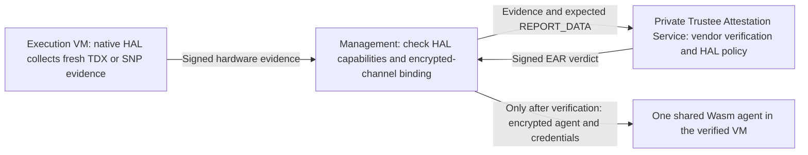

# Trustee verification for the portable HAL agent

This guide configures the HAL adapter for an independently installed Trustee
Attestation Service (AS). Infrastructure installation is managed by the operator.
The pinned image metadata is recorded in
[`examples/trustee/prebuilt-image.json`](examples/trustee/prebuilt-image.json).

Management now accepts `verifier: "trustee"` for **Intel TDX and AMD SEV-SNP**.
This is an additional backend; existing deployments keep their selected verifier
until the administrator changes their policy. No downgrade or fallback occurs
when Trustee is unavailable or rejects evidence.

The contract is pinned to Trustee **v0.22.0**, commit
`512fed65642015b849f38fb13bfdec7806639987`. Its REST API and EAR token format differ
from older Trustee examples. Review the adapter before upgrading that service.



Trustee handles the vendor verification backend; management remains the deployment
authority. The agent, per-user brokers, gVisor sandboxes, workload permissions,
private compiled caches, audit and undeployment paths keep their existing roles.
Trustee's Key Broker Service, Kubernetes and Kata are not required by this adapter.
For TDX, Trustee still uses Intel DCAP internally. Its SNP backend uses AMD
endorsement verification.

## Checks that remain mandatory

- The configured P-256 public signing key verifies the ES256 token. A token's
  embedded JWK, a fetched JWKS or a remote `verified` boolean cannot authorize it.
- The issuer, EAR profile, dedicated policy ID and signed HAL policy binding match.
  The CPU appraisal must affirm hardware, executables and configuration; the
  default/sample policy is not accepted.
- Token issuance must be fresh for this verification request, expiry must be in
  the future, and lifetime cannot exceed five minutes. Five seconds of issuance
  clock skew is allowed. Expired tokens are rejected without an expiry grace period.
- Both Trustee and management check the full 64-byte REPORT_DATA value. It is our
  existing SHA-512 binding of the management challenge, recipient channel key,
  agent/configuration hashes, destination, VM identity and capability manifest.
  This binds the application-level encrypted channel; it is not a TLS-exporter binding.
- TDX: exact MRTD and all four RTMRs, debug disabled, `UpToDate`, unexpired collateral.
- SNP: exact launch measurement, VMPL 0, debug disabled, migration-agent permission
  disabled, approved product and explicit minimum bootloader/TEE/SNP/microcode versions.
  AMD has no invented Intel `UpToDate` label. Result metadata records its checked
  TCB component versions.

The `hal.policy-binding` extension hashes the approved requirements, not arbitrary
Rego source. Management independently checks the security claims too. The local
`evidence_sha256` records the report submitted; it is not a separate Trustee-signed
claim about that digest. The signed fresh REPORT_DATA binds the attested channel.

The AS signer, policy store and service are part of management's trusted environment.
The standalone AS policy administration API must remain private. A new signer must
be explicitly approved; management never learns a replacement key from the service.

## Prepare the AS on management

Install the pinned Trustee v0.22.0 REST service using its
[upstream deployment instructions](https://github.com/confidential-containers/trustee/blob/v0.22.0/attestation-service/docs/restful-as.md).
Use the image digest in `examples/trustee/prebuilt-image.json` and adapt
`examples/trustee/as-config.json` to your installation. Keep a persistent signer,
private storage and the generated public signer key. The HAL policy must pin that
public key. A newly downloaded public key is not an independently trusted identity.

The HAL repository does not install Docker, provision the AS, or replace its
signer. Prepare those separately before generating the management policy. For
SNP, also build the report codec described below on management.

For a service listening on the documented loopback port:

```sh
curl --fail http://127.0.0.1:8080/healthz
```

Keep the AS administration endpoint private. A health response establishes
liveness, not policy approval or hardware verification. The AS needs appropriate
vendor collateral/endorsements or an approved offline store. A remote AS must use
HTTPS with a trusted CA and controlled administration access.

## Generate and install the approved policy

The pinned release exposes policy listing at `GET /policy`; it does not expose
`GET /policy/{policy_id}`. After uploading a policy, verify its listed ID and
compare its stored source with the generated Rego using the AS administrator's
access. Do not treat HTTP 404 as evidence of a successful policy installation.

Use your **already approved** TDX policy, or fill
`examples/trustee/tdx-approved.template.json` from the approved boot image release.
Do not replace reference values with values copied from an unverified target.
The template is intentionally invalid until the real reference values are supplied.

```bash
.venv/bin/python -m hal_fleet.trustee_policy \
  --policy state/approved-tdx.json \
  --signer-public-key "$HOME/hal-fleet/trustee/token-public.pem" \
  --output state/trustee/tdx-policy
curl --fail --request POST http://127.0.0.1:8080/policy \
  --header 'Content-Type: application/json' \
  --data-binary @state/trustee/tdx-policy/policy-upload.json
```

The generator also accepts an existing `intel-dcap` policy as `--policy`; it keeps
the approved measurements and removes the old verifier settings in the new output.
It creates a distinct policy ID derived from the approved requirements, the `_cpu`
Rego policy and the management JSON. It does not contact Trustee or overwrite
an existing output directory. The public signing key/optional TLS CA are embedded
in that JSON so it can be transferred with the management configuration. The AS private key is never packaged with it.

For AMD, build the management-side report codec with the project toolchain:

```bash
rustup run 1.98.1 cargo build --release --locked \
  --manifest-path tools/trustee-snp-codec/Cargo.toml
.venv/bin/python -m hal_fleet.trustee_policy \
  --policy state/approved-snp.json \
  --signer-public-key "$HOME/hal-fleet/trustee/token-public.pem" \
  --snp-codec tools/trustee-snp-codec/target/release/hal-trustee-snp-codec \
  --output state/trustee/snp-policy
curl --fail --request POST http://127.0.0.1:8080/policy \
  --header 'Content-Type: application/json' \
  --data-binary @state/trustee/snp-policy/policy-upload.json
```

Start `state/approved-snp.json` from the SNP template. Select `Milan` or `Genoa` and
set **all four** minimum TCB numbers from the approved platform baseline. Null
defaults are rejected. The codec's absolute management path and hash are pinned;
generate this policy on the management machine where that binary will run.
The codec uses the exact `sev` revision used by Trustee, requires a complete
version 3–5 report and checks byte-for-byte re-encoding before sending it. It does
not verify signatures; Trustee does that. It does not run in the worker or agent.

Point the existing management profile's `attestation_policy` to the generated
`attestation-policy.json`, then run the normal configuration command:

```bash
.venv/bin/python fleet.py configure-agent \
  --config state/fleet.json --profile state/portable/profile.json
.venv/bin/python fleet.py configure-agent \
  --config state/fleet.json --profile state/portable/profile.json --apply
sudo systemctl restart hal-fleet-management
```

Use the actual profile path if different. For multiple targets, set each
`execution_targets` entry's policy path as well; those entries take precedence
over the default policy. Restarting management clears existing verified sessions
so the new verifier/policy is used before another deployment. A deployed agent
keeps its VM ownership; verifier selection does not authorize another manager.

For automatic provisioning from the operator machine, `deploy --portable-profile`
still works: select the generated policy in the portable deployment profile.
The AS and, for AMD, the codec must already be installed on management at the
pinned path. The client-facing `onboard`, `run` and `bench` commands are unchanged.

## Portability limits and remaining platform work

| Area | What must exist on each target |
|---|---|
| Native host | A build for the target CPU/OS, compatible Wasmtime, HAL WIT version and required host functions. Wasm agent bytes can stay identical. |
| Evidence collection | A working Linux TSM report interface returning raw TDX/SNP evidence. Provider-specific vTPM/paravisor formats require separate collectors and policies. |
| Boot trust | Approved measurements and a measured/verified boot chain that authenticates HAL, gateway, launcher and configuration. A JSON declaration cannot make a mutable install measured. |
| Isolation | The approved gVisor profile, private IPC/mounts, no worker network, resource limits and per-user cache boundaries. No fallback to ordinary Docker. |
| Verification | Trustee vendor backend, usable endorsements/collateral and a separately approved policy for each platform/image release. |

The SNP adapter accepts Milan/Genoa **VCEK and VLEK** reports. For AWS VLEK,
the native collector includes the extended-report certificate table from Linux
TSM `auxblob`. Management bounds and translates it into Trustee's certificate-chain
format. Trustee must validate the AMD chain and report signature; merely receiving
a certificate does not establish trust. Both execution and management need this
support. Pinned Trustee still requires report versions
3–5; version 2 is rejected. Azure vTPM evidence, Turin's additional FMC policy and
other TEE families require separate adapters/policies and live validation.

Trustee does not independently prove every container launch, continuous runtime
integrity or arbitrary result correctness. Those claims still depend on the
approved runtime and the enforcement already described in `PORTABLE_AGENT.md`.

## Diagnosing a rejected appraisal

`Verifier/endorsement check passed` in the AS log means vendor evidence verification
passed. It does not mean the VM matches the approved boot measurements. Trustee
can return HTTP 200 with a signed EAR whose status is `contraindicated`.
Management must reject that result before deploying the agent.

For an authenticated appraisal under the pinned policy, management now names
failed measurement checks, for example `rtmr1, rtmr2`. This does not change the
policy or accept those reported values. Check the VM's boot history and kernel,
initramfs and boot-configuration changes, including automatic package updates.
Compare those changes with the independently reviewed baseline. A mismatch alone
does not establish which file changed or whether the change was authorized.

Restore the approved boot environment, or approve a new baseline after reviewing
the change, then generate and configure the reviewed policy again. Do not
copy live measurements into the approved policy merely to make deployment pass.

## Validation

```bash
.venv/bin/python -B tests/test_trustee.py
.venv/bin/python -B tests/run_trustee_checks.py
```

The first runs signed-token, request-format and rejection tests without Rust.
The second also builds the pinned SNP codec and evaluates generated policies with
Trustee's Rego engine. These tests use synthetic evidence and do not claim live
TDX/SNP verification. Live acceptance must check both hardware platforms with
approved images, successful deployment, and failures for wrong measurements,
wrong report binding, expired tokens, untrusted AS keys and missing endorsements.
Keep measured workload timings separate from session/attestation startup time.

Source contracts reviewed:
[release](https://github.com/confidential-containers/trustee/releases/tag/v0.22.0),
[REST API](https://github.com/confidential-containers/trustee/blob/v0.22.0/attestation-service/src/bin/restful/mod.rs),
[EAR signing](https://github.com/confidential-containers/trustee/blob/v0.22.0/attestation-service/src/ear_token/broker.rs),
[TDX verifier](https://github.com/confidential-containers/trustee/blob/v0.22.0/deps/verifier/src/tdx/mod.rs),
[SNP verifier](https://github.com/confidential-containers/trustee/blob/v0.22.0/deps/verifier/src/snp/mod.rs).
