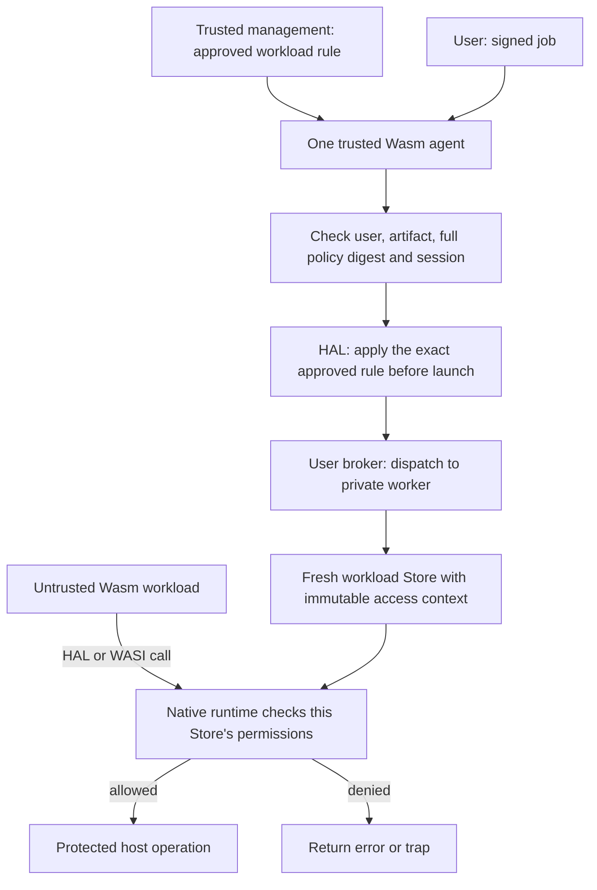

# Agent decisions and workload access

Management and the orchestration agent are trusted. Workloads are untrusted.
There is one agent per VM, one broker per active user, and a fresh Wasmtime Store
for each workload invocation. Workloads do not share the agent's Store, keys or
orchestration imports.

**The broker receives the rule; the rule restricts the workload.** Native host
functions consult the rule attached to that workload's execution context before
performing a protected operation. This is different from restricting the broker's
own OS process, which still needs container/OS controls and scoped credentials.



The workload rule belongs to a user and an approved artifact digest. It is applied
to each invocation; it is not an expiring permission file created for every run.
The agent verifies that broker authorization agrees with the approved artifact,
rule hash, user key, cache permission, output limit and broker session. Native HAL
also requires the policy to be applied before a workload can be launched.

## Existing rules and optional finer permissions

Every managed workload already requires a rule with `hal_permissions`, memory,
fuel, timeout, output and cache limits. No extra profile is required to retain this
protection. Broad grants include `crypto`, `random`, `clock` and scoped `storage`.

An optional `access_profile` inside that same rule narrows permitted operations:

| Reusable template | Permitted operations | Still denied |
|---|---|---|
| `compute` | No protected host operations | Crypto, storage, clock, random and platform metadata calls |
| `sha256` | HAL SHA-256 hashing | Other hashes, signing, verification and key generation |
| `signature-verify` | HAL signature verification | Signing and key generation |
| `storage-read` | Open own namespace, read, list, metadata | Write and delete |
| `storage-write` | Create/open own namespace, write objects | Read, list and delete |
| `random` | HAL random bytes and entropy information | Reseeding and WASI random APIs |
| `clock` | HAL clock reads | Sleep and WASI clocks |
| `platform` | Platform metadata | Other protected services |

`sha512`, `hashes`, `wasi-clock` and `wasi-random` templates are also provided.
The definitive operation/template list is
[`vendor/hal-access-profile/profile-v1.json`](vendor/hal-access-profile/profile-v1.json).
Additional operations may be explicitly chosen in a reviewed manifest; unknown
names are rejected. A profile can never enable a category absent from
`hal_permissions`, or grant network, attestation or orchestration access.

All 15 computational benchmark workloads pass with the same `compute` template.
They perform their algorithms inside Wasm; they do not require HAL crypto just
because an algorithm implements hashing internally. Restricting a host API does
not prohibit an algorithm written entirely in guest code.

## Enforcement details

- The profile includes an exact artifact SHA-256, operation allowlist, a protected
  host-call budget, and a maximum buffer size. Version 1 rejects unknown fields,
  duplicate/unknown operations, invalid limits and permissions above the rule.
- The profile is covered by the existing `rule_sha256` in the user-signed job.
  Management, the agent, broker and worker carry the same rule. Dropping, widening
  or substituting the profile changes that digest and is rejected.
- Each execution installs its own profile once. The workload cannot replace it.
  Code-cache hits reuse compiled code, never the Store, permissions or spent budget.
- Profiled components are checked against the supported host interface set before
  instantiation, including cache hits. A new interface requires explicit integration.
- HAL operation checks sit in the native host implementations. WASI clock/random
  checks use the pinned Wasmtime generated traits, including compatible interface
  versions. Broad `clock`/`random` grants are now also required for equivalent WASI
  calls, even when no finer profile is present. Previously these WASI services were
  available independently of the HAL permissions.
- Blocking HAL sleep and WASI clock subscriptions remain unavailable to managed
  workloads. No WASI host directories, environment, sockets or stdio are inherited.
- `max_host_calls` counts attempted operations protected by the finer profile;
  it is not a budget for every internal runtime operation or basic WASI I/O call.
  Fuel/time/memory/tenant quotas remain separate. `denied_calls` reports profile
  permission/budget denials, not every possible runtime error.
- Buffer checks cover protected variable-sized data requests; canonical ABI
  argument lifting can occur before the host check. These checks complement the
  existing memory and storage quotas; they do not replace them.

The profile reduces the host API exposed to a malicious workload. It does not
provide a private kernel, contain every Wasmtime/native-code vulnerability, or
restrict arbitrary OS syscalls if a native broker were taken over. Keep container
isolation, broker credentials and the trusted HAL/runtime boundary. The agent
remains the decision maker; it does not need a network round trip for each host call.

## Preparing profiles without per-workload files

Profile creation is an administrative publication step. Ordinary users still
select approved catalog names through the existing APIs. One template can cover
many artifacts, but each published rule binds it to its own artifact digest.

For a new, unpublished 15-workload catalog, on the management/build machine:

```sh
.venv/bin/python fleet.py profile-manifest --manifest benchmarks/artifacts/manifest.json --template compute --output reviewed/compute/manifest.json
```

PowerShell equivalent:

```powershell
& $HalPython fleet.py profile-manifest --manifest benchmarks/artifacts/manifest.json --template compute --output reviewed/compute/manifest.json
```

This verifies artifact bytes, prepares a new manifest and copies the necessary
artifacts locally. It does not publish, overwrite the input, contact a VM or grant
a user new rights. Windows clients do not need Rust for this command. Review the
manifest, then use the existing `fleet.py publish --manifest ...` command and its
operator/deployment arguments; enrollment and uploads still use the APIs.

For a mixed catalog, `--assignments mapping.json` replaces `--template`, with a
single JSON object mapping every manifest workload name to a template. The
generator never infers authorization from an import list or an LLM: imports show
possible dependencies, not the minimum rights a workload needs.

Existing catalog names remain immutable. Do not try to republish an existing name
with different rules. `--name-suffix=-p1` prepares versioned names. A user
can hold only one name/rule for the same artifact digest. For side-by-side evaluation,
use a separate test user and explicitly approve only the profiled catalog names;
do not use `--workloads all` when the catalog contains two versions of the same
artifact. Existing users and grants are not automatically migrated.

## Rollout and maintenance

Update the Python services and clients, then rebuild the native runtime, shared
orchestration agent and worker image together. Older clients do not include the
profile in their ticket digest and cannot submit profiled jobs.
Use the existing reviewed deployment/build approval process and update the
attestation allowlist for the intended runtime release where applicable. Do not
automatically approve changed binaries or disable attestation to adopt profiles.
Older services/runtimes reject the new field; they do not silently ignore it.
The legacy native baseline also explicitly rejects profiled workloads because it
does not install these rules. Existing unprofiled native benchmarks remain usable.

The source for the small profile library is kept separately in
`enforcement-service-profiles/profile-core`. HAL vendors an identical checked
snapshot so deployment remains a single repository. `UPSTREAM.json` records its
hashes; the regression suite detects accidental drift. The supplied enforcement
repository's prototype HTTP/LLM session service is not part of the execution path.
The original `enforcement-service-main` directory is unchanged.

After `build.py`, run `tests/run_architecture_checks.py`. The checks include real
Wasm execution, denied operations, signature binding, cache hits, two users with
different profiles and all 15 computational workloads. Local software fixtures
are not evidence of Docker containment or verified TDX hardware attestation.
